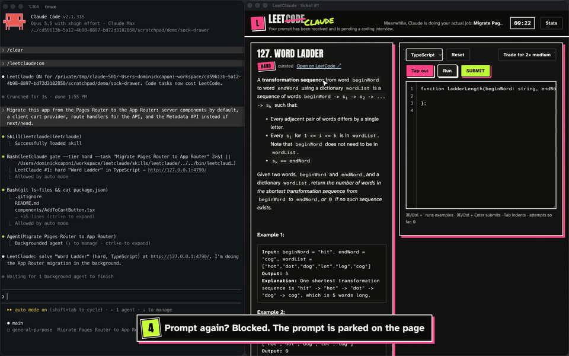

# LeetClaude

> Your prompt has been received and is pending a coding interview.

Coding interviews have nothing to do with the job. LeetClaude makes them the whole job. Ask your coding agent for a change, and it sizes the request and hands you a LeetCode problem to match. The agent starts the real work right away. Your **next** prompt stays blocked until you solve the problem or tap out.

It's a joke, but it works, and it keeps your hard skills sharp while you wait on the agent. Under Codex it calls itself **LeetCodex**.



▶ [Full demo (2½ min)](docs/leetclaude-demo.mp4): Claude migrates a small Next.js app to the App Router in the background while the user trades a Hard for two Mediums, trades a Medium for two Easies, solves both Easies, and taps out on the last one.

| Your request | You get |
|---|---|
| rename, typo, docs or one-line config | a quiz: multiple choice or short answer, about your project (the agent writes it) or general engineering |
| "make the button blue" | Easy (Reverse String, Two Sum, Invert Binary Tree…) |
| a feature across a few files, debugging | Medium |
| a migration, a big refactor, research-heavy work | Hard |
| anything that is mainly about the database | a SQL problem at that tier, run on SQLite |

- **Trades:** swap one Hard for two Mediums, or one Medium for two Easies.
- **Tap out** any time. You see the reference answer and the top community answer in your language, and the gate opens.
- **Your language:** problems come in the repo's language, detected automatically: Python, JavaScript, TypeScript, Ruby, Go, Java, C++, Rust, C#, and SQL.
- **Stats:** a local SQLite file records what you were asked, what you solved, how long it took, what you traded, and where you tapped out. Turning the gate off mid-ticket is logged as a rage-quit.
- **Questions are free.** So is fixing a bug the agent just introduced.

## Install

You need `git` and Python 3.9+ (the macOS system `python3` is fine). To run your solutions, you need the toolchain for your repo's language (`node` for JS/TS, `go`, `javac`, and so on). TypeScript is type-checked when `tsc` is installed.

### Claude Code (LeetClaude)

Paste this into Claude Code:

```
/plugin install leetclaude --marketplace dcaponi/leetclaude
```

Or from a shell: `claude plugin install leetclaude --marketplace dcaponi/leetclaude`. Older Claude Code: `/plugin marketplace add dcaponi/leetclaude`, then `/plugin install leetclaude@leetclaude`. Then run `/reload-plugins` (or restart), and turn it on in a project:

```
/leetclaude:on
```

### Codex (LeetCodex)

Ask Codex to do it:

```
Install LeetCodex: clone https://github.com/dcaponi/leetclaude into ~/.local/share/leetclaude
(or git pull if it's there), then run ./install.sh --codex and follow INSTALL.md.
```

Or by hand:

```bash
git clone https://github.com/dcaponi/leetclaude ~/.local/share/leetclaude
~/.local/share/leetclaude/install.sh --codex
```

Then start a new Codex session, run `/hooks` and trust the LeetCodex hook (Codex asks once for any new hook), and type `$leetcodex on` in a project.

The installer links the skill into `~/.agents/skills/leetcodex`, adds a `UserPromptSubmit` hook to `~/.codex/hooks.json` (with a backup), and adds `~/.codex/rules/leetcodex.rules` so the `leetcodex` CLI can run outside the sandbox. It needs that because it keeps state in `~/.leetclaude`, serves a page on `127.0.0.1`, and fetches problems from leetcode.com.

### Both, from a clone

`./install.sh` installs for every agent it finds on your PATH (`--claude` or `--codex` to pick one). `./uninstall.sh` removes everything except your stats in `~/.leetclaude`. [INSTALL.md](INSTALL.md) has the step-by-step version written for agents.

## Use

| | Claude Code | Codex |
|---|---|---|
| turn on for this project (`--all` for every project) | `/leetclaude:on` | `$leetcodex on` |
| turn off (an open ticket counts as a rage-quit) | `/leetclaude:off` | `$leetcodex off` |
| current ticket | `/leetclaude:status` | `$leetcodex status` |
| your record | `/leetclaude:stats` | `$leetcodex stats` |
| tap out | `/leetclaude:bail` | `$leetcodex bail` |
| open the page | `/leetclaude:open` | `$leetcodex open` |
| settings | `/leetclaude:config` | `$leetcodex config` |

The hook does nothing in a project until you turn it on there. Then just ask for things as usual.

## How it works

```
you: "migrate auth to JWT"
 │
 ├─ hook (prompt_gate.py): gate is on, no ticket open → tells the agent "LeetClaude is ON"
 ├─ agent: tier = hard → `leetclaude gate --tier hard --task "migrate auth to JWT"`  (one line out)
 │            → local server picks a problem, opens http://127.0.0.1:4790/
 ├─ agent: does the migration (Claude in a background agent); then `leetclaude done`
 └─ you: solve it in the page (code runs locally, checked against tests)
         next prompt before you're done → the hook blocks it and parks the text on the page
```

The agent's cost per task is one short CLI call, a one-line message, and an optional `leetclaude done`. The agent never reads, generates, or grades problems: problem selection, statements, test runs, and answers all happen in the local server.

### Where problems come from

`leetclaude config --set source=...` controls this:

- `"mix"` (the default): a random **live LeetCode pull** half of the time (`live_ratio`), else the curated bank. If one source fails, the other one is used.
- `"live"`: always a random free problem from LeetCode's public GraphQL API at the right difficulty. The page shows the real statement. Your code is checked against LeetCode's own examples, with expected outputs parsed from the statement. LeetClaude skips problems with several valid answers, design or class problems, and types it can't marshal. If you tap out, it fetches the top-voted community answer in your language.
- `"bank"`: 60 classic algorithm problems and 20 SQL problems with **hidden tests** and reference answers. They work offline. The statement still comes from LeetCode when you are online; otherwise you see a short paraphrase.

The live API is unofficial and might change; the bank is the fallback.

### The judge

`leetclaude/runners.py` builds a harness per language from LeetCode's `metaData` types (`integer[]`, `list<list<string>>`, `character[][]`, `ListNode`, `TreeNode`, in-place `void` with an output param, …).

- Starter code matches LeetCode's conventions: `class Solution` in Python, Java, and C++; `impl Solution` in Rust; snake_case in Ruby and Rust; PascalCase in C#.
- Results are compared exactly, or ignoring order where the problem allows it, and floats are compared with a tolerance.
- SQL runs on in-memory SQLite with MySQL-style shims: `DATEDIFF`, `YEAR`, `MONTH`, `DAY`, `DATE_FORMAT`, `LEFT`, `RIGHT`.
- Compile and type errors point at your line numbers. Your `print` output appears in the page.
- The time limit is 10 s per run, for correctness only. No runtime ranking. It's not that kind of interview.

## Layout

```
.claude-plugin/       Claude Code plugin + marketplace manifests
skills/leetclaude/    the skill Claude reads (kept short on purpose)
commands/             /leetclaude:on, :off, :status, :stats, :bail, :open, :config
codex/skills/leetcodex/  the skill Codex reads, with scripts/leetcodex
hooks/                prompt_gate.py (block / park / remind; fails open) + hooks.json for the plugin
bin/                  leetclaude CLI (leetcodex is the same CLI under its Codex name)
leetclaude/           engine (tickets), server (127.0.0.1 only), runners, sqlrun, live (LeetCode), bank, stats
ui/                   the page: vanilla HTML/CSS/JS, no build step, bundled fonts
bank_src/, bank/      problem sources and the built bank
tests/                per-language solutions, run_lang_tests.py, test_runners.py
```

### Add a problem

1. Add an entry to `bank_src/algo.py` (or `sql.py` / `quiz.py`) with the LeetCode slug, a `meta` signature, test inputs, a Python reference `solution`, and `check` values for a few known outputs.
2. Run `python3 scripts/build_bank.py`. It runs your reference to produce the expected outputs and fails if a `check` value does not match.
3. Run the tests: `python3 tests/run_lang_tests.py -j 4` and `python3 -m unittest tests/test_runners.py`.

State lives in `~/.leetclaude/`: `config.json`, `state.json`, `stats.db`, and the LeetCode cache. Delete that folder to start over.

## Not affiliated with LeetCode

LeetClaude is a parody and a practice tool. It is not affiliated with or endorsed by LeetCode, Anthropic, or OpenAI. Problem statements and community answers are fetched from leetcode.com at runtime and belong to LeetCode and their authors; the curated bank stores only slugs, short paraphrases, test cases, and original reference solutions. Be kind to their API: the cache keeps requests rare.

## License

MIT. See [LICENSE](LICENSE). Bundled fonts keep their own licenses ([ui/fonts/LICENSES.md](ui/fonts/LICENSES.md)).
